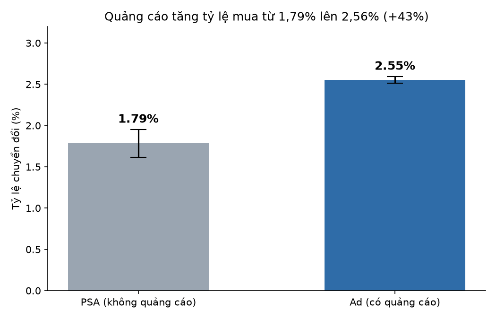
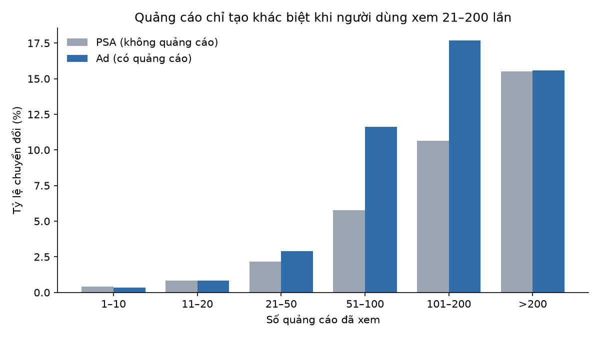
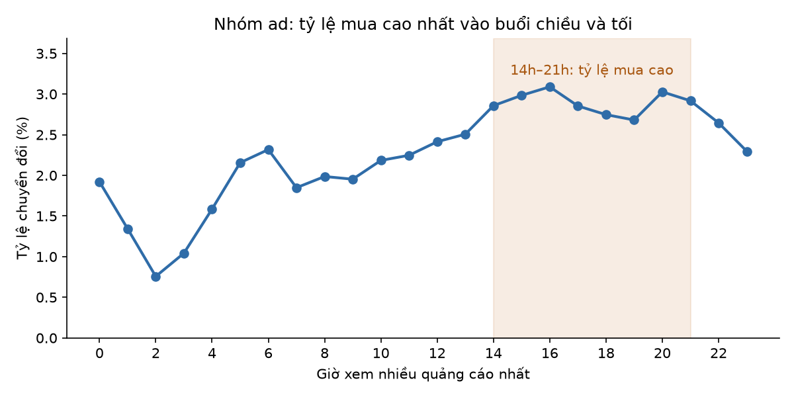

# Đánh giá hiệu quả chiến dịch quảng cáo bằng A/B test

**SQL (MySQL 8) · Python (pandas, SciPy, statsmodels) · Kiểm định giả thuyết · Khoảng tin cậy · Bootstrap · Power analysis**

Một công ty marketing chạy chiến dịch quảng cáo cho gần 590 nghìn người dùng: 96% được xem quảng cáo sản phẩm, 4% được giữ lại xem thông báo công ích (nhóm đối chứng). Dự án trả lời câu hỏi của quản lý: *quảng cáo có thực sự khiến khách mua nhiều hơn không, nhiều hơn bao nhiêu, và nên chạy quảng cáo thế nào cho hiệu quả?*

### Kết quả nổi bật

- **Quảng cáo có hiệu quả:** tỷ lệ mua tăng từ **1,79% lên 2,56%**, tức **+0,77 điểm %** (khoảng tin cậy 95%: 0,60–0,94) hay **lift +43%**. z = 7,37, p < 0,001.
- **Quy ra kinh doanh:** khoảng **769 người mua tăng thêm trên mỗi 100.000 người xem**. Riêng chiến dịch này mang về khoảng **4.343 đơn** nhờ quảng cáo.
- **Kết luận vững:** sau khi điều chỉnh theo ngày trong tuần, chênh lệch vẫn là 0,78 điểm %. Nhóm xem quảng cáo mua nhiều hơn ở cả 7 ngày.
- **Tần suất là chìa khóa:** quảng cáo chỉ tạo khác biệt khi người dùng xem **21–200 lần**. Dưới 20 lần (66% người dùng) gần như không có tác dụng, trên 200 lần thì bão hòa.

---

## 1. Bối cảnh và câu hỏi

| | |
|---|---|
| **Nhóm thử nghiệm (`ad`)** | Được xem quảng cáo sản phẩm, 564.577 người (96%) |
| **Nhóm đối chứng (`psa`)** | Được xem thông báo công ích (public service announcement), 23.524 người (4%) |
| **Chỉ số chính** | Tỷ lệ chuyển đổi = số người mua / số người trong nhóm |

**Giả thuyết:**
- H0: quảng cáo không làm thay đổi tỷ lệ chuyển đổi (p_ad = p_psa)
- H1: tỷ lệ chuyển đổi của hai nhóm khác nhau (p_ad ≠ p_psa)
- Mức ý nghĩa α = 0,05; power mục tiêu 80%

## 2. Dữ liệu

Nguồn: [Marketing A/B Testing – Kaggle](https://www.kaggle.com/datasets/faviovaz/marketing-ab-testing). Mỗi dòng là một người dùng.

| Cột | Ý nghĩa |
|---|---|
| `user_id` | Mã người dùng |
| `test_group` | `ad` hoặc `psa` |
| `converted` | Người dùng có mua hay không |
| `total_ads` | Tổng số quảng cáo đã xem |
| `most_ads_day` | Ngày trong tuần xem nhiều quảng cáo nhất |
| `most_ads_hour` | Giờ trong ngày xem nhiều quảng cáo nhất |

Repo không chứa file dữ liệu. Tải về và đặt vào `data/marketing_AB.csv`.

## 3. Cấu trúc repo

```
marketing-ab-test/
├── README.md
├── requirements.txt
├── sql/
│   ├── 01_load_data.sql         nạp CSV vào MySQL
│   ├── 02_data_checks.sql       kiểm tra dữ liệu, tạo bảng sạch ab_clean
│   ├── 03_conversion.sql        tỷ lệ chuyển đổi, lift, z-score, số đơn tăng thêm
│   └── 05_segments.sql          phân tích theo ngày, số quảng cáo, giờ
├── notebooks/
│   └── ab_test_analysis.ipynb   (Bước 4) z-test, khoảng tin cậy, bootstrap, power, biểu đồ
├── images/                      biểu đồ dùng trong README
└── data/                        (không đưa lên GitHub) marketing_AB.csv
```

## 4. Quy trình

| Bước | Việc | Công cụ |
|---|---|---|
| 1 | Nạp dữ liệu | SQL |
| 2 | Kiểm tra chất lượng dữ liệu và cách chia nhóm | SQL |
| 3 | Tỷ lệ chuyển đổi, lift, số đơn tăng thêm | SQL |
| 4 | Kiểm định thống kê: z-test, khoảng tin cậy, bootstrap, MDE | Python |
| 5 | Kiểm tra độ vững và phân tích sâu | SQL + Python |

## 5. Kiểm tra dữ liệu trước khi phân tích

| Kiểm tra | Kết quả |
|---|---|
| Trùng người dùng | 588.101 dòng = 588.101 người, không trùng |
| Ô trống, giá trị lạ | Không có |
| Người nằm ở cả 2 nhóm | 0 |
| Khoảng giá trị | Số quảng cáo 1–2.065 (trung bình 24,8); giờ 0–23 |
| **Tỷ lệ chia nhóm (SRM)** | **96,00% / 4,00%**, khớp đúng thiết kế *holdout* (giữ lại 4% không xem quảng cáo). Không có lỗi chia mẫu |
| Hai nhóm có tương đồng không | Giống nhau về số quảng cáo trung bình (24,8 và 24,8) và giờ xem (14,5h và 14,3h); **lệch về tỷ lệ xem nhiều nhất vào cuối tuần** (28,5% so với 25,2%), xem mục 7 |

Bảng sạch `ab_clean` giữ đủ 588.101 dòng, chuyển `converted` về 0/1.

## 6. Kết quả chính



| Nhóm | Số người | Số người mua | Tỷ lệ chuyển đổi |
|---|---:|---:|---:|
| psa (không quảng cáo) | 23.524 | 420 | 1,785% |
| ad (có quảng cáo) | 564.577 | 14.423 | 2,555% |

| Chỉ số | Giá trị |
|---|---|
| Chênh lệch tuyệt đối | **+0,769 điểm %** |
| Khoảng tin cậy 95% (Wald) | 0,595 đến 0,943 điểm % |
| Khoảng tin cậy 95% (bootstrap, 10.000 lần) | 0,596 đến 0,939 điểm % |
| Lift | **+43,1%** (bootstrap 95%: 30,5% đến 57,7%) |
| z-score (SQL và Python khớp nhau) | 7,37 |
| p-value (hai phía) | ≈ 1,7 × 10⁻¹³ |
| MDE với cỡ mẫu này (α = 0,05, power 80%) | 0,247 điểm %. Hiệu ứng quan sát lớn gấp 3,1 lần |

**Kết luận:** bác bỏ H0. Quảng cáo làm tăng tỷ lệ chuyển đổi một cách có ý nghĩa thống kê. Dù nhóm đối chứng chỉ 4%, cỡ mẫu vẫn đủ lớn để phát hiện hiệu ứng.

**Quy ra kinh doanh:** nhóm ad có 14.423 người mua. Nếu không có quảng cáo, ước tính chỉ khoảng 10.080 người, tức **khoảng 4.343 đơn tăng thêm nhờ quảng cáo**, hay **769 đơn trên mỗi 100.000 người xem**. Chiến dịch có lời khi `769 × lợi nhuận mỗi đơn` lớn hơn chi phí hiển thị quảng cáo cho 100.000 người.

## 7. Kiểm tra độ vững: lệch lịch cuối tuần có làm sai kết luận không?

Ở bước kiểm tra, nhóm ad có tỷ lệ xem nhiều nhất vào cuối tuần cao hơn nhóm psa (28,5% so với 25,2%). Nếu tỷ lệ mua thay đổi theo ngày, chênh lệch giữa hai nhóm có thể một phần do lịch xem chứ không do quảng cáo. Cách kiểm tra: so sánh hai nhóm **trong cùng một ngày**.

| Ngày | ad | psa | Chênh lệch (điểm %) |
|---|---:|---:|---:|
| Thứ Hai | 3,32% | 2,26% | +1,07 |
| Thứ Ba | 3,04% | 1,45% | +1,60 |
| Thứ Tư | 2,54% | 1,58% | +0,96 |
| Thứ Năm | 2,16% | 2,02% | +0,14 |
| Thứ Sáu | 2,25% | 1,63% | +0,62 |
| Thứ Bảy | 2,13% | 1,40% | +0,73 |
| Chủ nhật | 2,46% | 2,06% | +0,40 |

- Nhóm ad mua nhiều hơn ở **cả 7 ngày**.
- Chênh lệch **đã điều chỉnh theo ngày là 0,778 điểm %**, gần như bằng 0,769 khi chưa điều chỉnh, nên kết luận không đổi.
- Mỗi ngày nhóm psa chỉ có khoảng 3.000 người, nên không kết luận riêng cho từng ngày (ví dụ +0,14 ở thứ Năm có thể chỉ do dao động ngẫu nhiên).

## 8. Phân tích sâu: tần suất, ngày và giờ

### Tần suất quảng cáo



| Số quảng cáo đã xem | % người dùng | ad | psa | ad − psa (điểm %) |
|---|---:|---:|---:|---:|
| 1–10 | 44,3% | 0,33% | 0,40% | ≈ 0 |
| 11–20 | 21,7% | 0,84% | 0,82% | ≈ 0 |
| 21–50 | 22,2% | 2,92% | 2,18% | +0,74 |
| 51–100 | 7,8% | 11,63% | 5,77% | **+5,86** |
| 101–200 | 2,9% | 17,68% | 10,64% | **+7,04** |
| > 200 | 1,0% | 15,58% | 15,50% | ≈ 0 |

Hai cách đọc bảng:

1. **Đọc từ trên xuống:** tỷ lệ mua tăng theo số lần hiển thị **ở cả nhóm psa**, là nhóm không xem quảng cáo sản phẩm. Vậy người dùng tích cực vừa được hiển thị nhiều vừa mua nhiều. Đây là **tương quan, không phải nhân quả**.
2. **So ad với psa trong cùng một mức:** đây là tác động thật của quảng cáo. Tác động bằng 0 dưới 20 lần, rõ rệt từ 21–200 lần, và biến mất trên 200 lần (bão hòa).

### Ngày và giờ (nhóm ad)



- **Ngày:** thứ Hai (3,32%) và thứ Ba (3,04%) cao nhất; thứ Bảy thấp nhất (2,13%).
- **Giờ:** khung **14h–21h** có tỷ lệ mua khoảng 2,7–3,1%, đỉnh lúc 16h (3,09%) và 20h (3,03%). Từ 1h–3h sáng thấp nhất (0,76–1,34%).

Phân tích theo ngày và giờ là **quan sát**, không phải thí nghiệm, nên chỉ dùng làm gợi ý.

## 9. Đề xuất

1. **Tiếp tục chiến dịch:** quảng cáo tạo thêm khoảng 769 đơn trên mỗi 100.000 người xem. Bước tiếp theo là ghép với chi phí và lợi nhuận mỗi đơn để tính ROI.
2. **Quản lý tần suất hiển thị:** tập trung đưa người dùng lên mức **20–200 lần**, đặt **giới hạn khoảng 200 lần** mỗi người để không lãng phí ngân sách vào nhóm đã bão hòa.
3. **Ưu tiên lịch chạy:** dồn ngân sách vào **thứ Hai, thứ Ba** và khung **14h–21h**.
4. **Kiểm chứng bằng thí nghiệm tiếp theo:** đề xuất 2 và 3 dựa trên dữ liệu quan sát. Nên chạy A/B test riêng, chia ngẫu nhiên **tần suất** (ví dụ giới hạn 50 / 100 / 200 lần) và **khung giờ**, để đo tác động nhân quả.
5. **Duy trì nhóm holdout:** tiếp tục giữ 4% người dùng không xem quảng cáo để theo dõi hiệu quả theo thời gian.

## 10. Giới hạn

- Nhóm đối chứng chỉ 4% nên khoảng tin cậy khá rộng (lift 30–58%). Con số 43% nên được báo cáo kèm khoảng này.
- `total_ads`, `most_ads_day`, `most_ads_hour` được ghi nhận **trong lúc** thí nghiệm, không được chia ngẫu nhiên. Phân tích theo các cột này chỉ mang tính gợi ý.
- Ở mức trên 200 quảng cáo, nhóm psa chỉ có khoảng 240 người, nên kết quả ở mức này kém chắc chắn.
- Dữ liệu không có chi phí quảng cáo hay giá trị đơn hàng, nên chưa tính được ROI.
- Dữ liệu không ghi thời gian chạy thí nghiệm, nên không kiểm tra được hiệu ứng mới lạ (novelty effect) hay xu hướng theo thời gian.

## 11. Cách chạy lại

1. Tải `marketing_AB.csv` từ Kaggle, đặt vào `data/`.
2. Nạp vào MySQL: mở cmd **tại thư mục `data`**, chạy:
   ```
   mysql -u root -p --local-infile=1 --default-character-set=utf8mb4 --table < ../sql/01_load_data.sql
   ```
3. Chạy các file SQL còn lại tại thư mục gốc repo, ví dụ:
   ```
   mysql -u root -p --default-character-set=utf8mb4 --table < sql/02_data_checks.sql > ket_qua_02.txt
   ```
4. Cài thư viện Python: `pip install -r requirements.txt`. Mở `notebooks/ab_test_analysis.ipynb` (VS Code hoặc Jupyter) → **Restart + Run All**.

---

**Tác giả:** Nguyễn Bá Hồng Minh
